# Easy Node Dialogue System - User Manual

[Unity Asset Store](https://assetstore.unity.com/packages/slug/390618) | [GitHub](https://github.com/Saris-S/ends)

## 1. Overview

Easy Node Dialog System is a node-based dialog tool for Unity. Author branching conversations, localize text, apply variable consequences, show character sprites and play dialogs in your game. MCP clients can inspect and edit the same database alongside the visual editor.

### Feature guide

| Task | Where to start |
|---|---|
| Write branching conversations | [Graph controls](#5-graph-canvas-controls) and [node types](#6-node-types) |
| Let an AI client inspect and edit dialogs | [Connecting an MCP client](#connecting-an-mcp-client) |
| Review pending edits before saving | [Changes panel](#changes-panel) |
| Identify AI edits in the graph | [AI edit highlighting](#ai-edit-highlighting) |
| Save one dialog while keeping other work pending | [Save and discard](#19-editor-save-and-discard-behavior) |
| Give rewards or spend a variable value | [Numeric consequences](#numeric-consequences) |
| Translate a database in a spreadsheet | [CSV import and export](#16-localization-csv-import--export) |
| Read and change variables from game code | [Runtime variables](#13-runtime-variables-and-save-file) |

### Requirements

- **TextMeshPro** (required for the core dialogue UI).
- **Input System** (required **only** for the RPG sample scene).

### Quick start (samples)

The fastest way to try ENDS is to open a sample scene. Each sample already includes a Dialog Window, a Dialog Database and dialog activators. Asset Store samples are inside the ENDS folder, Package Manager samples appear under `Assets/Samples` after import.

1. In a new project, import **TMP Essential Resources** from the **Window -> TextMeshPro** menu if they are not installed yet.
2. In the imported samples, open **`RPG Game Sample.unity`** or **`Visual Novel Sample.unity`**.
3. Press **Play**.
4. **RPG:** move to an NPC, press the interaction key (see sample UI / `NpcDialogInteraction`). **VN:** select **DialogActivator** on the scene, click **Start dialog** in the Inspector.

To use dialogs in your game, follow [Runtime setup and API](#12-runtime-setup-and-api). Sections 14 and 15 describe the sample scenes.

### Upgrading from the old Core folder layout

Version 2.0 reorganizes the package into `Runtime`, `Editor`, `Samples` and `Documentation`. Import the complete new version over the installed package. ENDS reconnects its assemblies and automatically moves known package files to the current layout while preserving their GUIDs. No separate upgrade package is required.

1. Back up the project before upgrading.
2. Keep your original **Dialog Database** assets. If you customized the sample databases, scenes or prefabs, deselect their replacements in Unity's import window. The package samples are not replacements for your own content.
3. Import the complete ENDS scripts, assembly definitions, assembly references and `Editor/PackageUpgrade` files. Wait for compilation and automatic folder migration to finish.
4. Open an original database in ENDS and verify its graph, translations, name colors, variable references and runtime playback. Save and reopen it to check the upgraded content.

The empty scripts in `Editor/PackageUpgrade/Legacy` are intentional compatibility placeholders. Their original names and GUIDs replace obsolete 1.0 scripts during import, preventing duplicate classes. Folder migration does not save or rewrite database assets. It stops if a destination is occupied by another file, preserving both files and reporting the conflict in Console.

### How this manual is organized

| Part | Sections | Topic |
|---|---|---|
| **I - Authoring** | [2](#2-opening-the-editor) to [11](#11-variables-tab) | Dialog Editor: databases, graph, nodes, names, sprites, variables |
| **II - Runtime** | [12](#12-runtime-setup-and-api) and [13](#13-runtime-variables-and-save-file) | Scene setup, components, variables and save files |
| **III - Samples** | [14](#14-rpg-sample) and [15](#15-visual-novel-sample) | RPG and Visual Novel scenes |
| **IV - Reference** | [16](#16-localization-csv-import--export) to [18](#18-assembly-definitions) | CSV, voice clips and assembly references |
| **V - Saving work** | [19](#19-editor-save-and-discard-behavior) | Pending edits, selected-area Save/Discard, Undo and logs |
| **Contact the Developer** | [20](#20-contact-the-developer) | Contact |

**Where to start:**

- **Write dialogs** → Part I (start at section 2).
- **Play dialogs in a scene** → Part II (section 12), then samples in Part III if needed.
- **Replace the standard UI** → section 12 only.

---

## Part I - Authoring (Dialog Editor)

## 2. Opening the editor

Open the editor through:

`Tools -> Easy Node Dialog System`

The version 2.0 highlights appear when Unity Editor starts, once per session. An optional review request appears when you open ENDS, starting from its second opening. Use **Don't show again** to disable either prompt. You can reopen them through **Window -> Easy Node Dialog System -> What's New / Support the Developer**.

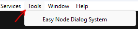

*Fig. 1: Open The Editor*

The editor has three main tabs:

- **Text:** dialogs, graph, categories, languages, character display names.
- **Character Sprites:** character sprite database.
- **Variables:** variable definitions and runtime values.

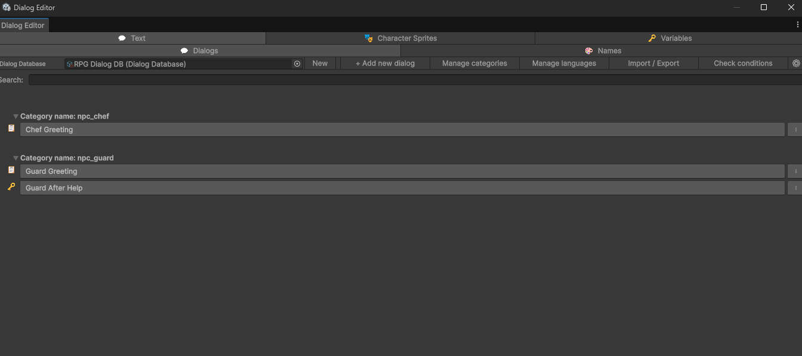

*Fig. 2: Main Dialog Editor Window*

### Create your first dialog

A **Dialog Database** is the asset that stores your dialogs, variable definitions, languages, names and character sprites. You can keep several dialogs in one database.

1. Open **Text > Dialogs** and use **New** beside the database field to create a database asset.
2. In **Manage languages**, add the language codes you need if they are not already listed.
3. Click **+ Add new dialog**. Its graph opens with a Start node.
4. Click **+ Add line** and enter text under a language foldout.
5. Click the Start node's output, then the Line node's input to connect them.
6. Open **Changes**, select the dialog and any pending shared data under **Other unsaved areas**, then click **Save selected**.

Edits remain in working editor data until you save them through ENDS. Runtime playback uses the saved database asset. To play this dialog in a scene, continue with [section 12](#12-runtime-setup-and-api).

### Connecting an MCP client

This is an optional workflow for editing through an AI application or another MCP client. You can author dialogs entirely in the Unity editor without connecting a client.

Open the editor settings and expand **ENDS MCP**. Copy the displayed **URL** into your MCP client's HTTP server settings. Each application stores its own connection settings. ENDS does not read or modify client configuration files.

A typical workflow:

1. Connect the client to the displayed URL and ask it to find the intended Dialog Database.
2. Ask the client to inspect the dialog or create/edit content. The available tools cover dialogs, nodes, connections, conditions, consequences, translations, variables, names and character sprites.
3. Review its pending work in **Changes** and inspect the highlighted fields on the graph.
4. Save the selected areas when ready, or discard them to restore their saved state. Client edits stay pending unless the client explicitly saves them.

Several clients can work on different dialogs. **Exclusive editing** prevents two clients from editing the same claimed area, and **Take control** lets the local editor reclaim a dialog.

- **Status:** Running means the server is listening. Stopped means it is disabled. Starting or Retrying means startup is pending. Error means startup has failed.
- **Preferred port / Apply:** change the preferred local port. The default is 3847. If it is occupied, ENDS can select a nearby free port, so use the actual displayed URL and update your client when that URL changes.
- **Start / Stop / Restart:** control the local server. Stop disables automatic startup and cancels queued requests that have not started. Clients may need to reconnect after Restart.
- **Clients:** expand to see **Open sessions** and **Closed sessions**. Cards show the client, request activity and last activity time. Hover for connection details. **x** and **Clear closed** remove closed records. An Open record means a server session exists. The application may no longer be online.

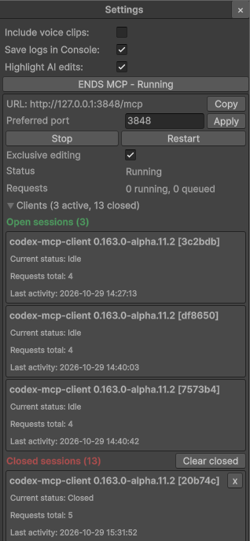

#### Collaborative editing

**Exclusive editing** is enabled by default. Opening an available dialog in Unity claims it for the local editor. A dialog owned by a client opens read only with its owner visible. **Take control** reclaims it for manual editing. **Back to list** releases the local dialog claim.

Disconnecting a client or letting its claim expire preserves pending work. Review it through [Changes](#changes-panel), then save or discard the selected areas. Disabling Exclusive editing removes ownership restrictions. Requests are still checked for conflicting changes before they are applied.

Saving a dialog with unsaved dependencies may require selecting shared data or other dialogs too. The complete user workflow is in [section 19](#19-editor-save-and-discard-behavior).

---

## 3. Text tab - dialog list

The Text tab has two subtabs:

- **Dialogs:** create and edit dialog graphs.
- **Names:** manage character name colors and display name translations (section 9).

This section covers the **Dialogs** subtab: the database slot, the top toolbar (left to right), dialog rows, and the per-dialog context menu.

### Dialog list overview

The Dialogs subtab shows:

- **Top row:** Dialog Database slot, toolbar buttons, and (below) optional search.
- **Dialog rows:** one row per dialog - open graph, warning marker, context menu.

A dialog row can also show [AI edit highlighting](#ai-edit-highlighting). For the options shown when leaving a dialog with pending work, see [Leaving a dialog or switching databases](#leaving-a-dialog-or-switching-databases).

For the overall layout, see the main editor screenshot in section 2.

The subsections below follow the top row **left to right**, then dialog rows and the context menu.

### Dialog Database slot

At the left of the top row:

- **Dialog Database object field:** select the database asset used by the editor.
- **New:** create a new Dialog Database asset.

While a dialog graph is open, the object field and **New** are disabled. A hint icon explains that you must use **Back to list** before switching databases.

All toolbar actions below apply to the assigned database.

### + Add new dialog

Creates a new dialog in the current database with a default **Start** node and opens it in the graph editor.

### Manage categories

Opens a popup to edit dialog initiators/categories.

- **Add:** adds a new category name.
- **Rename:** starts editing an existing category. The row then shows **Save** and **Cancel** for that draft.
- **Delete:** removes a category after confirmation. Its dialogs are moved to the default category.

Adding, renaming or deleting updates working editor data. The row's **Save** confirms its rename draft. To persist the result, save the affected areas through **Changes**.

Category names are used by **DialogActivator** as initiators. Redirect nodes filter target dialogs by category.

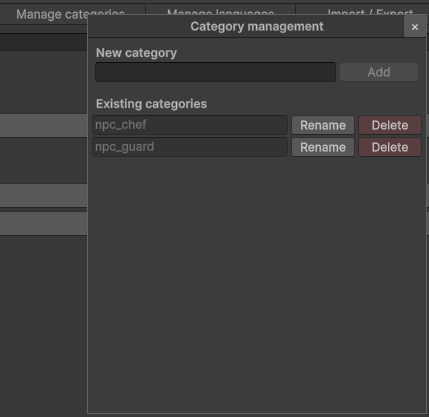

*Fig. 12: Manage Categories Popup*

### Manage languages

Opens a popup to define language codes for Line/Choice text and character display names.

- **Add:** adds a language code.
- **Rename:** starts editing a language code. The row then shows **Save** and **Cancel** for that draft. Renaming also updates texts using the old code.
- **Delete:** removes a language after confirmation.

When you **delete** a language from the list, Line, Choice, and name-color texts for that code are removed from the database.

These operations update working editor data. Save shared data and affected dialogs together through **Changes** to persist them.

#### Texts without language slot

If dialog or name-color texts use a language code that is **not** in **Existing languages**, the popup lists them at the bottom with entry counts.

- **Add:** adds the code to Available languages so the texts appear in the editor and runtime lookup.
- **Delete texts:** removes those text entries from dialogs and name colors. The language list is unchanged.

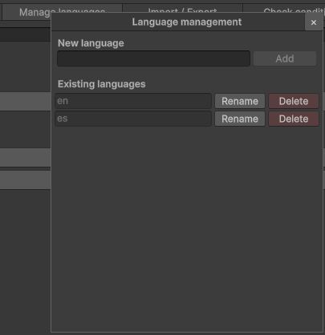

*Fig. 13: Manage Languages Popup*

### Import / Export

Opens the localization import/export popup (CSV).

- **Format:** file format dropdown (currently CSV).
- **Export:** saves a CSV for the assigned Dialog Database.
- **Import:** reads a CSV and writes texts back into matching keys.

CSV layout, Key format, and import rules are in section 16.

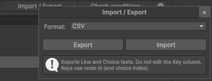

*Fig. 14: Import / Export Popup*

### Check conditions

Validates **all** dialog start conditions in the database and reports overlaps, multiple defaults per category, and ambiguous matches.

Results appear in an editor dialog. See [section 8](#8-validation) for checks and the scenario limit.

### Settings (gear)

Opens editor settings for the current Dialog Database.

- **Include voice clips:** when enabled (default), each language foldout on a Line node shows a Voice row.
- When disabled, the editor asks for confirmation, clears all assigned voice clips in the database, and hides Voice UI.
- **Save logs in Console:** when enabled (default), writes save/discard messages to the Unity Console. Log examples and save rules are in section 19.
- **Highlight AI edits:** shows unsaved AI edits in yellow and saved AI edits in green, including dialog rows. Alt acknowledges saved green marks only.

Line node authoring and runtime playback are in section 17.

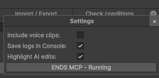

*Fig. 15: Settings Popup*

Save logs identify the database, the triggering action, the saved area and whether a graph is open. For examples and the persistence rules, see [section 19](#19-editor-save-and-discard-behavior).

### Dialog rows

Each row in the list:

- **Dialog name button:** opens the graph editor for that dialog.
- **Warning marker:** appears when validation finds an issue.
- **Menu button:** opens context actions for that dialog.

### Dialog context menu

- **Duplicate:** duplicates the dialog and its nodes.
- **Move to/[category]:** changes dialog category/initiator.
- **Delete:** deletes the dialog and marks redirect references as missing.

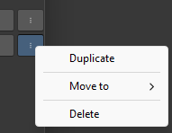

*Fig. 16: Dialog Context Menu*

---

## 4. Dialog graph toolbar

When a dialog is open, the graph toolbar appears above the canvas.

### Toolbar controls

- **Back to list:** returns to the dialog list.
- **Show conditions:** opens/closes the start condition side panel.
- **Check integrity:** finds broken node links and offers fixes.
- **Check conditions:** validates start condition overlaps in the current category.
- **Go to start:** centers the canvas on the Start node.
- **Save:** saves the current dialog. Other dialogs and shared data remain pending unless selected through **Changes**.
- **Changes:** opens the right-side panel for reviewing unsaved differences, selecting areas, saving or discarding, and viewing recent activity. The graph canvas keeps its size.
- **Auto and interval:** enable auto-save and choose its interval in minutes. Auto-save applies to the current dialog.
- **+ Add line:** creates a Line node.
- **+ Add choice:** creates a Choice node.
- **+ Add condition:** creates a Condition node.
- **+ Add Redirect:** creates a Redirect node.
- **Initiator popup:** assigns the current dialog to a category/initiator.

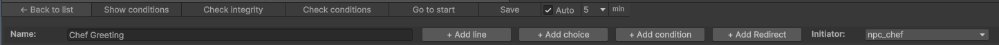

*Fig. 17: Graph Toolbar*

---

## 5. Graph canvas controls

### Mouse controls

- **Drag node header:** move a node.
- **Mouse wheel:** zoom in/out.
- **Middle mouse drag:** pan the canvas.
- **Left mouse drag on empty canvas:** draw a selection rectangle around nodes.
- **Drag the selected group's frame:** move the selected nodes together.
- **Click Scale:** reset zoom to 100%.
- **Click output port, then input port:** create a connection.
- **Right-click port:** open connection menu.
- **Right-click empty graph area:** open node creation menu.
- **Escape:** cancel a pending connection.

### Port menus

- **Disconnect:** removes an existing connection from that port.
- **Target node names:** connect to another node directly from the menu.

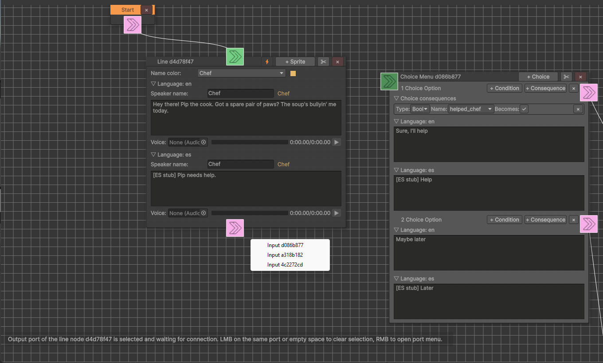

*Fig. 18: Graph Canvas and Ports*

### Context node creation menu

- **Add Start Node:** creates a Start node if one does not already exist.
- **Add Line Node:** creates a Line node.
- **Add Choice Node:** creates a Choice node.
- **Add Condition Node:** creates a Condition node.
- **Add Redirect Node:** creates a Redirect node.

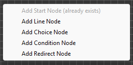

*Fig. 19: Right Click Node Creation Menu*

### Node labels and permanent IDs

Node headers show **Node** followed by a short ID, for example **Node LNN.2**. The prefix identifies the node type:

| Prefix | Node type |
|---|---|
| `STN` | Start |
| `LNN` | Line |
| `CHN` | Choice |
| `CDN` | Condition |
| `RDN` | Redirect |

The number is an identity, not the node's current position or playback order. Moving a node keeps its ID. Different dialogs can contain the same local ID, so external text keys also include the dialog name.

A Choice node contains **options**, displayed as **Option 1**, **Option 2**, and so on in their current list order. Each option also has a permanent ID such as `OPT.3`, used by CSV and editing tools. Removing an earlier option changes the visible numbering, but keeps the surviving option's identity. Repeated blocks such as conditions, consequences and animations are also tracked independently, so deleting one block and adding another can be distinguished from editing the original.

### Changes panel

Open **Changes** on the graph toolbar to compare pending work with the last saved version. It includes manual and client edits, and groups them by their owning node and nested block.

| Marker | Meaning |
|---|---|
| Yellow, **(changed)** | An existing object or field differs from its saved version |
| Green, **(added)** | The object was added after the last save |
| Red, **(removed)** | The saved object was removed from the working version |

Expand a node to inspect its changes. An option owns its next-node connection, translations, conditions and consequences. Individual blocks have headings such as **Condition 1 (added)** or **Translation en (changed)**, so separate objects remain distinguishable.

Changed fields use **old value → new value**, for example **Value: 7 → 8**. Only changed branches are shown. Dependent changes are nested under the field that changed their meaning, for example a variable type change and its affected variable, operator and value. A type change can therefore show **Value: 7 → 7** when the visible text is unchanged but the value has a different type. Added and removed blocks show their contents for review.

An added object removed again before saving no longer differs from the saved version, so it disappears from pending Changes. **Recent activity** is a separate record of recent operations, including actions that no longer produce a pending difference. It is not a permanent version history.

The current dialog is selected by default when it has unsaved changes. Expand **Other unsaved areas** to include other dialogs or shared catalogs and settings. **Save selected** persists the selected areas. **Discard selected** restores their saved versions after confirmation. Selection applies to areas, not individual field rows. If a dialog uses a newly added variable or another unsaved dependency, select those areas together. See [section 19](#19-editor-save-and-discard-behavior).

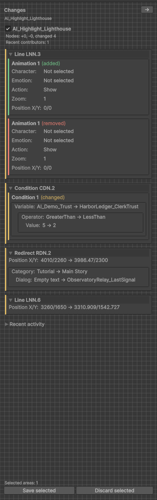

### AI edit highlighting

Enable **Highlight AI edits** in Settings to mark client-authored edits in dialog rows and graph controls:

- **Yellow:** pending AI edits.
- **Green:** saved AI edits awaiting acknowledgement.
- **Alt over a green mark:** acknowledge it and clear the mark. Pending yellow marks remain until the work is saved or discarded.

Fields are tracked independently. Manually editing a marked field clears its AI mark, while unrelated marked fields remain visible. A newly created block can also have a marked background.

These colors describe AI edit state. The green and red markers in **Changes** describe additions and removals, including manual edits.

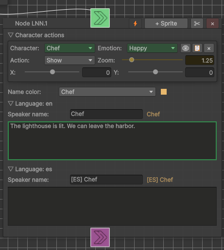

### Graph FPS counter

The diagnostic FPS label beside the zoom indicator measures actual graph repaints. It falls to **FPS: 0** when the graph is idle. This is editor redraw activity, not the game's runtime frame rate.

---

## 6. Node types

Connect nodes to define the playback path. A **Choice** node contains selectable **options**. Each option has its own text and outgoing connection.

Conditions have three uses: start conditions select a dialog, a Condition node branches within a dialog, and an option's conditions control its visibility. Where **&& / ||** is available, AND (`&&`) requires all conditions to pass and OR (`||`) requires at least one to pass.

### Start node

The entry point of a dialog. A dialog should have one Start node.

#### Controls

- **Output port:** connect to the first node in the dialog.

If a dialog has no Start node, create one through the canvas context menu. **Add Start Node** is disabled when one already exists.

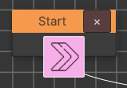

*Fig. 20: Start Node*

### Line node

Displays dialog text and optional character sprite actions.

#### Toolbar controls

- **x:** delete node.
- **Duplicate:** duplicate node.
- **+ Sprite:** adds a character action to the line.
- **Instant toggle:** when enabled, the node applies sprite/text changes and advances without waiting for a click.

#### Content fields

- **Name color:** speaker entry from the Names list, providing the display name and color.
- **Language foldouts:** text and optional speaker display name for each language.
- **Voice:** optional `AudioClip` per language (ObjectField, scrubber preview in the editor). Hidden when voice clips are disabled in Settings (section 3, Fig. 15). See section 17.
- **Character actions:** show/hide character sprites, set emotion, position, and zoom.

#### Character action buttons

- **Preview:** opens the sprite preview window.
- **Copy:** copies action parameters.
- **Paste:** pastes copied action parameters.
- **x:** removes the action.

The preview uses the selected sprite's own region, including sprites sliced from a shared texture. Character position and zoom are applied in the preview. **Show solo** displays only the selected sprite. **Show all** displays the sprites on the same Line node together.

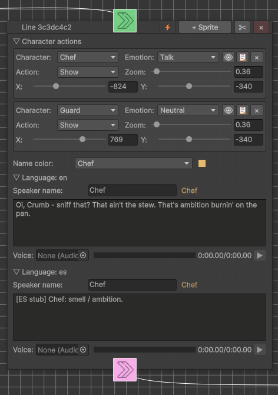

*Fig. 21: Line Node*

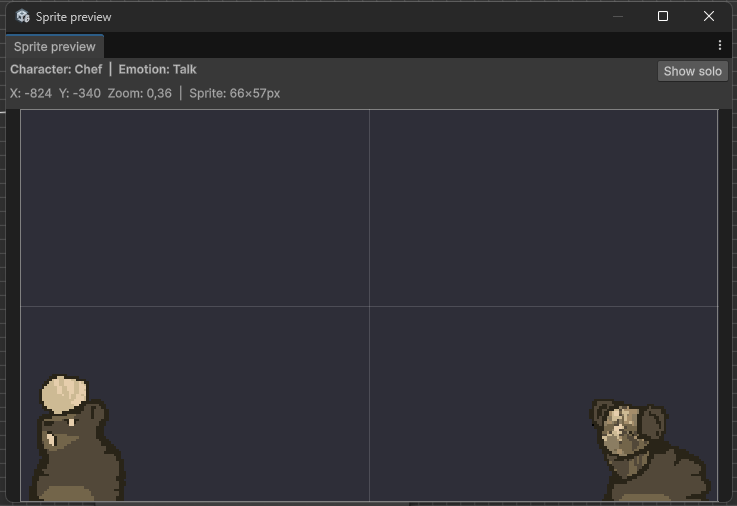

*Fig. 22: Sprite Preview Window*

### Choice node

Shows selectable answers to the player.

#### Toolbar controls

- **x:** delete node.
- **Duplicate:** duplicate node.
- **+ Option:** adds an option with its own text, conditions, consequences and output.

#### Option controls

- **x:** delete the option.
- **+ Consequence:** add a variable change applied when the option is selected.
- **+ Condition:** add a visibility condition for the option.
- **&& / ||:** switch option visibility conditions between AND and OR. The control appears when the option has at least two conditions.

#### Option fields

- **Translations:** localized option text.
- **Next node output:** connect the option to the next dialog node.
- **Conditions:** variable checks that decide whether the option is visible.
- **Consequences:** variable changes applied after selecting the option.

#### Numeric consequences

For **Int** and **Float** variables, select an operation beside the consequence value:

| Operation | Example | Result |
|---|---|---|
| `=` | `gold = 10` | Sets gold to 10 |
| `+=` | `gold += 10` | Adds 10 to the current gold value |
| `-=` | `gold -= 10` | Subtracts 10 from the current gold value |

For a reward, add a consequence for `gold`, choose `+=`, and enter the reward amount. For a purchase, use `-=` and add a visibility condition such as `gold >= 10` if the option should only be available when affordable. Subtraction itself does not impose a minimum value.

Consequences run in list order when the player selects the option, using the current runtime values. If multiple consequences affect the same variable, each reads the result left by the previous one. **Bool** and **String** consequences use assignment. Existing consequences keep `=` by default.

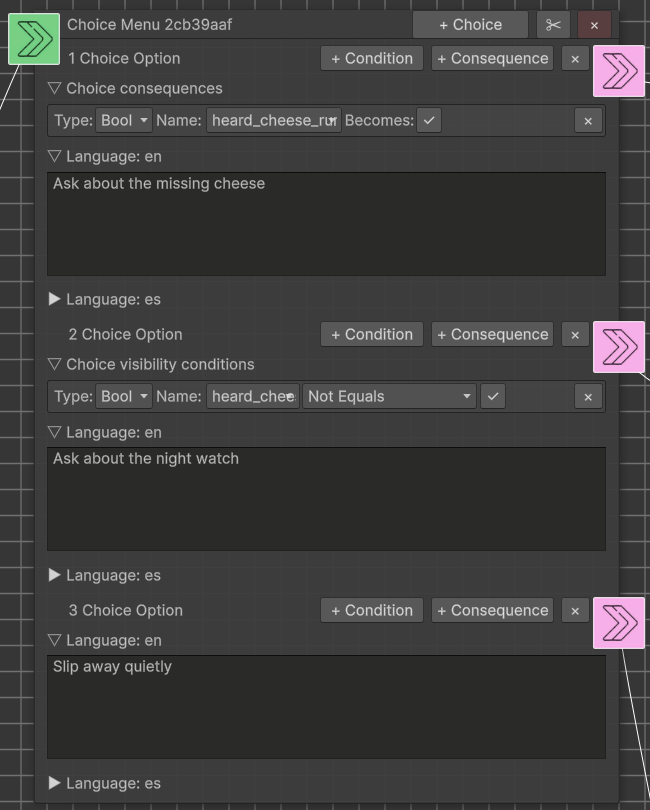

*Fig. 23: Choice Node*

### Condition node

Branches the dialog based on variable conditions.

#### Toolbar controls

- **x:** delete node.
- **Duplicate:** duplicate node.
- **+ Condition:** add a condition row.
- **&& / ||:** switch logic between AND and OR. The control appears when there are at least two conditions.

#### Ports

- **Input port:** connect previous node.
- **True output:** used when conditions pass.
- **False output:** used when conditions fail.

#### Condition fields

- **Variable type:** Bool, Int, Float, String.
- **Variable:** variable from the Dialog Database.
- **Operator:** Equals, NotEquals, GreaterThan, LessThan, GreaterThanOrEquals, LessThanOrEquals.
- **Value:** comparison value.

Int and Float support all listed operators. Bool and String support Equals and NotEquals. String values are useful for named states such as `quest_stage = "reward_ready"`, and can be assigned by option consequences or game code.

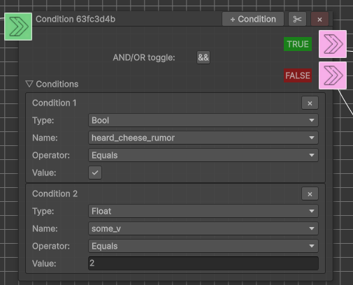

*Fig. 24: Condition Node*

### Redirect node

Redirects playback to another dialog.

#### Controls

- **Category:** target dialog category.
- **Dialog:** target dialog name.
- **Help box:** explains which dialogs can be selected as targets.
- **x:** delete node.
- **Duplicate:** duplicate node.

#### Rules

- Redirect targets are dialogs without evaluable start conditions, or locked dialogs excluded from normal category selection. Redirect uses the selected target directly.
- Creating a Redirect or changing its category selects and stores the first eligible target in name order, when one exists.
- An explicitly cleared target stays empty and is displayed as **(not selected)**. A category without eligible targets displays **(no redirect targets)**.
- Deleting a target dialog marks its reference as missing. Recheck redirects after moving targets to another category or changing their eligibility.

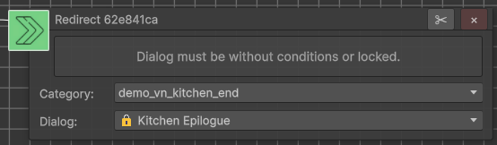

*Fig. 25: Redirect Node*

---

## 7. Start conditions panel

Open it with **Show conditions** in the graph toolbar.

This panel defines when a dialog is eligible for a category/initiator. At runtime, `TryStartDialogForInitiator` checks conditional dialogs in database order and selects the first match. If none match, it uses the first eligible dialog without evaluable start conditions as the default. A default placed earlier in the database does not override a later matching conditional dialog.

### Controls

- **Close arrow:** hides the conditions panel.
- **Help box:** explains how start conditions affect dialog selection.
- **Validation warning:** appears when overlapping start conditions are detected.
- **Lock:** makes the dialog redirect-only by excluding it from automatic category/initiator selection. Redirect can still target it directly. The lock does not mean an MCP client owns the dialog.
- **+ Add condition:** adds a start condition row.
- **&& / ||:** controls whether all conditions must pass or any condition may pass. The control appears when there are at least two conditions.

### Condition row fields

- **Variable type**
- **Variable name**
- **Operator**
- **Expected value**
- **Missing reference warning** if a variable was removed.

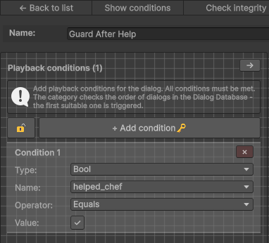

*Fig. 26: Start Conditions Panel*

---

## 8. Validation

### Check integrity

Use **Check integrity** in the graph toolbar.

It checks:

- Broken next-node references.
- Option outputs that point to deleted nodes.
- Condition true/false outputs that point to deleted nodes.
- Redirect targets that no longer resolve or are no longer eligible.

When possible, the validator offers a fix action.

### Check conditions

Use **Check conditions** in the dialog list or graph toolbar.

It checks:

- Overlapping start conditions that let several dialogs in the same category match the same variable values.
- Multiple default dialogs in the same category.

The overlap check samples variable-value combinations, with a maximum of **1024 scenarios per category**. If additional combinations remain, a warning in the Unity Console identifies the category and explains that the check is incomplete. A truncated search can miss overlaps even when none are reported. This limit applies to editor diagnostics, not runtime condition evaluation.

### Renaming and deleting referenced data

Renaming variables, character names or sprites updates their dialog references. Deleting a referenced entry preserves a **Missing** diagnostic so you can locate and repair the affected fields. Redirects to deleted dialogs are handled the same way. Select a replacement or remove the affected block, then review and save the changed areas together.

---

## 9. Names subtab

Open: `Text -> Names`.

This section controls speaker display names and text colors.

### Controls

- **Dialog Database slot:** select/create the Dialog Database.
- **+ Add name color:** add a new character name entry.
- **x:** delete a name color entry.
- **Name:** internal character/speaker key used by Line nodes.
- **Color:** speaker name color.
- **Name translations:** display name per language.
- **Preview:** shows the translated name in the selected color.

Deleting a name marks references as missing in dialogs instead of silently breaking them.

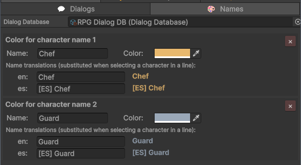

*Fig. 29: Names Subtab*

---

## 10. Character Sprites tab

Open: `Character Sprites`.

This section edits character sprite groups stored in the Dialog Database and used by Line node character actions.

### Controls

- **Dialog Database slot:** select/create the Dialog Database that stores character sprites.
- **+ Add character:** create a character group.
- **Search/filter field:** filter visible characters.
- **+ Add sprite:** add a sprite/emotion entry to a character.
- **Character rename button:** rename a character and update dialog references.
- **Sprite rename button:** rename an emotion and update dialog references.
- **Delete:** remove a sprite entry.
- **Missing reference help:** tells where a sprite/character is still used or was removed.

### Characters and emotions

- **Character:** named group.
- **Sprite/emotion:** named sprite inside a character group.

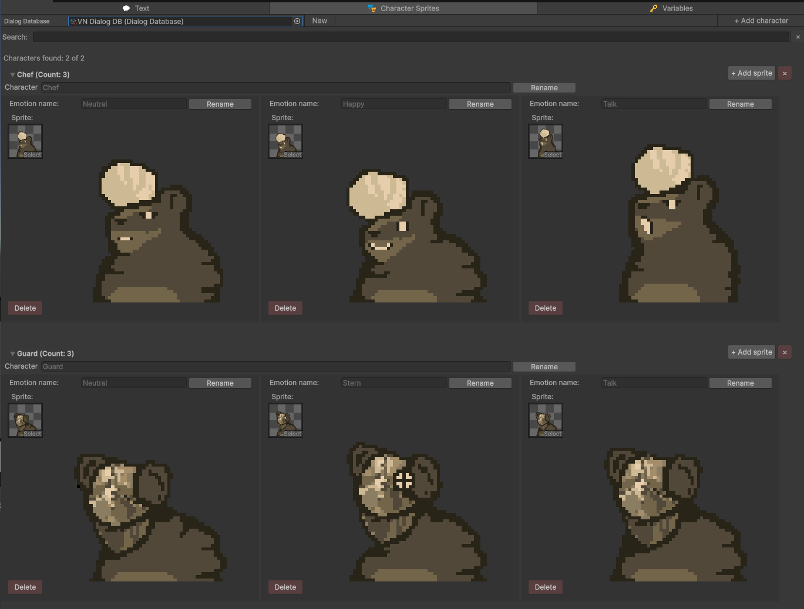

*Fig. 30: Character Sprites Tab*

### Runtime usage

Line node **Character actions** (Show/Hide) → **DialogCharacterPortraitPresenter** (section 12).

---

## 11. Variables tab

Open: `Variables`.

The variable system has two layers:

- **Template:** variable definitions in the Dialog Database (name, type and default value).
- **Current:** runtime values in `G`.

### File controls

- **Dialog Database slot:** select/create the Dialog Database that stores variables.
- **Load Current from save.json:** load runtime values from the save file.
- **Save Current to save.json:** write runtime values to disk.
- **Open save.json:** open the save file location/file.

### Creating a variable

- **Variable name:** new variable key.
- **Variable type:** Bool, Int, Float, String.
- **Default value:** initial value defined in the database.
- **+ Create variable:** add it to the database and initialize runtime value in `G`.

### Editing existing variables

- **Template / Save:** edit and apply the variable name, type and default value to working database data. Persist it through **Changes** with shared data selected, plus affected dialogs when references change.
- **Current / Save:** edit and apply a value in runtime memory (`G`). Use **Save Current to save.json** to write it to disk.
- **x:** delete a variable and mark references as missing.

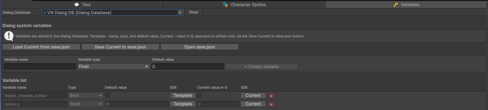

*Fig. 31: Variables Tab*

---

## Part II - Runtime integration

## 12. Runtime setup and API

**DialogRunner** plays a saved Dialog Database and evaluates its conditions and consequences. **DialogWindow** provides the default UI. Input, voice audio, character portraits and variable-file persistence are supplied by separate components that you can keep or replace.

### Set up playback in your scene

1. Add **`Runtime/DialogWindow/Dialog Window.prefab`** to the scene. It includes the default Runner, UI, variable save, input and audio components.
2. Assign your saved Dialog Database to **Dialog Database** on **DialogRunner**.
3. Add **DialogActivator** to a scene object and select the initiator/category you want to play.
4. Enter Play Mode and click **Start dialog** in the activator's Inspector.

The Runner selects a dialog using the [start-condition rules](#7-start-conditions-panel). Save authoring changes through ENDS before testing them at runtime.

For character sprites, add **DialogCharacterPortraitPresenter** and assign its container and slot prefab. For NPC interaction, follow the [RPG sample](#14-rpg-sample).

### Runtime components

| Component | Purpose | When to use it |
|---|---|---|
| **DialogRunner** | Plays dialogs and exposes playback events and commands | Required for playback |
| **DialogWindow** | Displays text and options | Use the default dialog UI |
| **DialogCharacterPortraitPresenter** | Shows and hides character sprites | Use sprite actions authored on Line nodes |
| **DialogLegacyInput** | Calls `Advance()` for the default continue controls | Use legacy input instead of your own input integration |
| **DialogAudioPlayer** | Plays localized Line voice clips | Use the default voice playback |
| **DialogSave** | Loads and saves `G` variables, with optional save on dialog end | Persist dialog variables in a file |
| **DialogDebugger** | Reports runtime diagnostics | Inspect playback problems |
| **DialogActivator** | Starts a dialog for an initiator/category | Use a scene object to trigger playback |
| **DialogPreferences** | Stores language preferences | Use the supplied language settings |

The default choice button prefab uses **DialogChoiceButtonUI**. Character portrait slots use **DialogCharacterPortraitSlotUI**. Restyle these prefabs to change their appearance.

### DialogRunner

Assign **Dialog Database**, then control playback with `StartDialog`, `TryStartDialogForInitiator`, `Advance`, `SelectChoice` and `CancelDialog`.

Subscribe to presentation events such as `LineReady` and `ChoicesReady`, session events `DialogStarted`, `DialogEnded` and `DialogCancelled`, and diagnostics through `DiagnosticReported`.

**ChoiceSelected** fires after the selected option's consequences have updated `G`, and before playback advances or the dialog ends. Game code can subscribe to react to the selection and read its updated variable values.

To pause gameplay during a conversation, subscribe to `GameplayFreezeRequested` in your game code. The RPG sample demonstrates this in **DialogRunnerToGameplayBridge**.

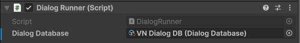

*Fig. 3: DialogRunner Inspector*

### Customizing the default UI

| Goal | Where to work |
|---|---|
| Restyle text bar, fade, choice layout | **Dialog Window** prefab + **DialogChoiceButtonUI** prefab |
| VN standing sprites | **DialogCharacterPortraitPresenter** + **DialogCharacterPortraitSlotUI** prefab |
| Different continue / choose input | **DialogLegacyInput** or your Input System / UI buttons → `Advance` / `SelectChoice` |
| Voice routing / mixer | **DialogAudioPlayer** or your audio module on Runner events |
| Replace UI entirely | Follow [Replacing the default UI](#replacing-the-default-ui) |

### DialogWindow (default View)

Assign the text bar, speaker and main text fields, options panel and choice button prefab (**DialogChoiceButtonUI**). Assign **Diagnostic Line Text** if you want diagnostics shown in the UI.

DialogWindow responds to Runner events and reports when opening, line presentation and closing have finished. Its option buttons call `SelectChoice`.

For additional messages, use `ShowTextBarMessage` on the idle text bar or `ShowDiagnosticLineDuringDialog` during a conversation.

Start playback through the Runner or an activator. Use **DialogCharacterPortraitPresenter** to display character sprites.

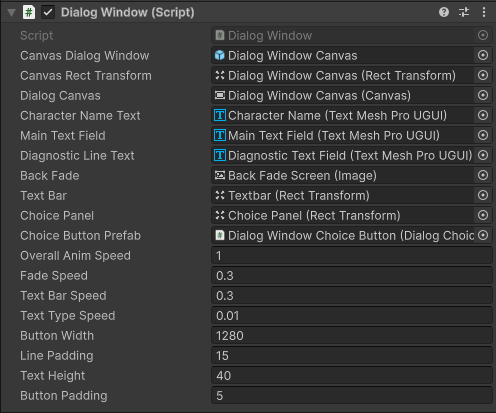

*Fig. 4: DialogWindow Inspector*

### DialogCharacterPortraitPresenter (optional)

This component reads sprite actions from `LineReady.CharacterActions` and clears portraits when the dialog ends or is cancelled.

Assign **Characters Container** and a slot prefab containing **DialogCharacterPortraitSlotUI**. Missing sprites produce a warning while dialog playback continues.

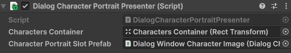

*Fig. 32: DialogCharacterPortraitPresenter Inspector*

The remaining component inspectors are shown below. **DialogLegacyInput** has no Inspector settings. Add it for the default continue controls.

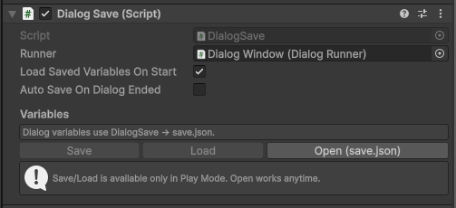

*Fig. 5: DialogSave Inspector*

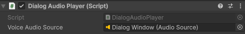

*Fig. 7: DialogAudioPlayer Inspector*

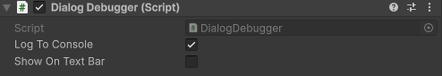

*Fig. 8: DialogDebugger Inspector*

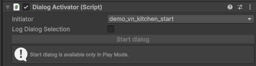

*Fig. 9: DialogActivator Inspector*

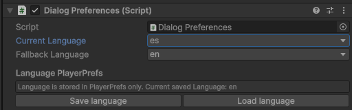

*Fig. 10: DialogPreferences Inspector*

### Replacing the default UI

1. Keep **DialogRunner** and assign **Dialog Database**. Keep **DialogSave** if you use the supplied variable-file persistence.
2. Remove or disable **DialogWindow**. Replace input, audio or portrait components only if your integration supplies those features too.
3. Subscribe your UI to the events below and report completion through the corresponding Runner methods.

| Runner event | Your UI's response |
|---|---|
| `DialogStarted` | Open the UI, then call `NotifySessionOpened` |
| `LineReady` (non-instant) | Present the line, then call `NotifyLinePresentationReady` |
| `LineSkipRequested` | Complete the text reveal, then call `NotifyLinePresentationReady` |
| `ChoicesReady` | Display options and call `SelectChoice(index)` with the selected presentation's `Index` |
| `DialogEnded` / `DialogCancelled` | Close the UI, then call `NotifySessionClosed` |

Instant lines advance without waiting for `NotifyLinePresentationReady`. After `CancelDialog`, your UI must still close and call `NotifySessionClosed` to finish the session.

Automatic playback is limited to **4096 node visits per uninterrupted traversal**, including transitions through Conditions, Redirects and instant Lines. Exceeding this budget raises `DiagnosticReported` with `TransitionLimitExceeded` and cancels the dialog through `DialogCancelled`. **DialogDebugger** logs the dialog name and node ID when Console logging is enabled. Ordinary story cycles that wait for player input remain valid, each later input starts a fresh budget. Synchronous input calls from presentation callbacks share the current traversal budget.

The complete event API is in **DialogRunner**, with presentation payloads in **DialogPresentations.cs**. To change only appearance, keep DialogWindow and restyle its prefabs instead.

---

## 13. Runtime variables and save file

### Variable values and persistence

| Layer | Use for |
|-------|---------|
| **`G` (static)** | Read/write dialog variables during gameplay (`SetBool`, `GetInt`, …). Used by `DialogRunner` for conditions and choice consequences. |
| **`DialogSave` (component)** | Initialize variables from the database, load/save `save.json` and optionally save on `DialogEnded`. |
| **`G.SaveGame()` / `G.LoadGame()` (advanced)** | Editor tools (Variables tab, custom inspector), tests, or your own tooling. In shipped games prefer **`DialogSave.Load()` / `DialogSave.Save()`** so persistence stays in one place. |

Typical Play Mode flow with **DialogSave** on the scene:

1. The Runner or DialogSave initializes `G` from the database defaults when needed.
2. If **Load Saved Variables On Start** is enabled, DialogSave overlays values from `save.json` for variables still defined in the database. You can also call `Load()` explicitly.
3. Gameplay and dialog consequences update `G` in memory.
4. Call `Save()` to persist those values, or enable **Auto Save On Dialog Ended**.

### Supported types

- Bool
- Int
- Float
- String

Conditions and consequences work without DialogSave. Add it when you need file persistence. `G.EnsureInitialized(database)` preserves current values when that database is already initialized. To reset to database defaults, call `DialogSave.InitializeVariables()` or `G.InitializeFromDefinitions(database)` explicitly.

### Runtime API

Use the `ALTUSHKA.EasyNodeDialogSystem` namespace in your game scripts. For example:

```csharp
G.SetBool("quest_started", true);
bool started = G.GetBool("quest_started");
G.SetInt("gold", 10);
G.SetString("quest_stage", "reward_ready");
string stage = G.GetString("quest_stage");
```

An empty name passed to `Get*` or `Set*` throws `ArgumentException`. Reading an unknown name returns the type's default value (`false`, `0` or `""`). Use the same names and types as the variable definitions in your database.

### Persistence API

In the example below, `dialogSave` is a reference to the **DialogSave** component in your scene.

```csharp
// Preferred in builds (DialogSave on scene):
dialogSave.Load();
dialogSave.Save();

// Advanced / editor / tests:
G.LoadGame();
G.SaveGame();
```

`DialogSave.Load()` and `DialogSave.Save()` report file outcomes through the Console. If your code needs a result, use `G.TryLoadGame()` or `G.TrySaveGame()`. They return a `G.FileResult` with `Success`, `Missing`, `Path`, `Version` and `Error`. A missing file leaves current values intact. An invalid file fails before applying any loaded values.

### Default save path

```text
Application.persistentDataPath/save.json
```

Play Mode and editor:

- **DialogSave** inspector: **Save**, **Load**, **Open (save.json)**.
- **Variables** tab: **Save Current to save.json**, **Load Current from save.json**, **Open save.json** (calls `G` directly).

### Save files and game updates

Each save includes **`saveVersion`** (currently `1`). Older files without the field are treated as version 1.

Loading applies values only to variables initialized from the current database definitions. For example, if you remove `old_quest_flag` from the database, its entry in an old save file is ignored. Renaming a variable also changes its save-file key. Migrate old player saves in your game code if you need to preserve values under renamed keys.

Writes use a **temp file + replace** so a crash mid-save is less likely to corrupt the main `save.json`.

The save file stores dialog variables. It does not store the current dialog/node, read-line history, multiple slots, cloud state or the rest of your game state. Use your own save system for those features.

`G` is shared runtime storage. For separate variable files, pass a custom path to `Load(path)` and `Save(path)` or use your own persistence module.

---

## Part III - Samples

## 14. RPG sample

The RPG sample demonstrates player movement, NPC proximity, interaction prompts and dialog selection by initiator. Its playback components are described in section 12.

**Sample-only scripts:** `NPC`, `NpcInteractionTriggerRelay`, `NpcDialogInteraction`, `DialogRunnerToGameplayBridge`, `Player Controller` / `Player State` / `Player Controls`.

**Scene checklist:** Dialog Window prefab + Dialog Database on Runner + **DialogActivator** on NPCs + **NpcDialogInteraction** on scene + **DialogRunnerToGameplayBridge** on player. Optional: **DialogPreferences**, **DialogDebugger** (wire **Diagnostic Line Text** on DialogWindow), voice on **DialogAudioPlayer**.

---

## 15. Visual novel sample

The Visual Novel sample uses the Dialog Window prefab, **DialogCharacterPortraitPresenter** (section 12, Fig. 32) and **DialogActivator**. It does not require the RPG NPC scripts. **DialogAudioPlayer** provides optional voice playback.

Start playback with the activator's **Start dialog** button in Play Mode or its `TryStartDialog()` method. From game code, use `DialogRunner.TryStartDialogForInitiator` for category selection. To start a specific dialog, find its entry in `DialogRunner.DialogDatabase.Dialogs` and pass it to `StartDialog(entry)`.

---

## Part IV - Reference

## 16. Localization CSV import / export

Open from the Dialogs list toolbar: **Import / Export** (section 3, Fig. 14).

Use CSV to send Line and option texts to translators and import their translations back into the database.

### Translation workflow

1. Check the language codes in **Manage languages**.
2. Open **Import / Export** and export the database as CSV.
3. Edit the language cells in a spreadsheet or translation tool. Keep the **Key** column unchanged.
4. Import the translated CSV. If it contains new language codes, choose whether to add them to the database's language list.
5. Review the result in **Changes** and save the affected dialogs. Include shared data if you added languages.

### Popup controls

- **Format:** file format dropdown (currently CSV).
- **Export:** saves a CSV for the assigned Dialog Database.
- **Import:** reads a CSV and writes texts back into matching keys.

### Exported content

- Line node texts (per language).
- Option texts (per language).
- Not exported: speaker names, voice clips, sprite actions, conditions, consequences.

### CSV layout

- First column: **Key**
- Next columns: one column per language code from Manage languages (for example `en`, `ru`)

### Text keys

Keep exported keys unchanged. They identify existing text entries:

- Line text: `{dialogName}.{nodeId}.line`
- Option text: `{dialogName}.{nodeId}.{optionId}`

Example:

```csv
Key,en,fr
Chapter1_Intro.LNN.2.line,Hello!,Bonjour !
Chapter1_Intro.CHN.3.OPT.1,Yes,Oui
Chapter1_Intro.CHN.3.OPT.4,No,Non
```

Keys use the dialog name as written, including spaces. Dots separate key parts and cannot be used in dialog names. The dialog scope distinguishes identical local node IDs in different dialogs. `OPT.4` identifies one permanent option, regardless of its current visible number. Reordering options or removing a different option does not redirect its translation to another option. A removed option's key is skipped. A replacement option receives a new key.

Use a fresh export after renaming a dialog, replacing nodes/options or importing an older database. CSV files using the previous slash-separated key format also require a fresh export. Keep exported keys unchanged in the translator's copy.

### Import rules

- Matching keys update existing Line or option texts.
- Unknown or malformed keys are reported and skipped.
- A blank cell clears existing text for that row and language. It does not mean "leave unchanged".
- Rows and language columns omitted from the file are left unchanged.
- Duplicate keys, empty or duplicate language headers, broken quoting and rows with the wrong number of columns reject the import before any text is applied.
- Voice clips and other non-text fields are unchanged.
- If the CSV contains language columns that are **not** in Manage languages, the editor asks before import:
  - **Add:** adds those language codes to Available languages, then imports.
  - **Import only:** imports texts without adding the codes to the language list. These entries remain in working data and can be saved, but stay hidden in the editor until you add the language through **Manage languages**.
  - **Cancel:** aborts import.

### File format and saving

- Save spreadsheet exports as **UTF-8, comma-separated CSV**. Semicolon-delimited files are not the expected format. Commas, quotes and multiline text are supported when correctly CSV-quoted.
- Export includes columns from Manage languages only. Orphan texts (language codes in nodes but not in the list) are not exported until you add the language.
- Graph Save does not remove texts for languages outside Available languages. Use **Delete language** or **Delete texts** in Manage languages to clean them up.
- Import updates working editor data and can be undone. It does not save the database asset automatically. Follow the review and save steps above to persist it.

---

## 17. Line voice clips

Line nodes can store one optional voice `AudioClip` per language.

### Enable / disable

In the Dialogs list toolbar, open **Settings (gear)** (section 3, Fig. 15):

- **Include voice clips:** when enabled (default), each open language foldout on a Line node shows a Voice row.
- When disabled, the editor asks for confirmation, clears all assigned voice clips in the database, and hides Voice UI.

### Authoring in a Line node

Inside each language foldout:

- **ObjectField:** drag-drop an AudioClip or pick one with the Unity object picker (wav, mp3, ogg, aiff, and other formats Unity imports as AudioClip).
- **Scrubber + time:** preview position (`current/total`). Dragging while preview is playing pauses playback and resumes on mouse up from the new position. Dragging while stopped only moves the playhead.
- **Play / Pause:** editor preview only (does not use DialogWindow).

### Runtime playback

1. Add **DialogAudioPlayer** to the scene (included on the Dialog Window prefab).
2. Add an **AudioSource** on the same object or a child.
3. Assign the AudioSource to **Voice Audio Source** on DialogAudioPlayer.
4. At runtime, DialogAudioPlayer plays `LineReady.VoiceClip` for the current language and stops on choices, dialog end/cancel, or line skip.
5. Instant Line nodes do not play voice.

### Notes

- Clips are Unity asset references on the Dialog Database, not embedded audio bytes.
- Large VO libraries: prefer splitting Dialog Databases by chapter so one asset does not pull every clip at once.
- CSV localization does not include voice clip paths. Assign clips in the editor.
- The editor preview has no volume control. Configure runtime volume on the assigned AudioSource or its Audio Mixer Group.

---

## 18. Assembly definitions

If your game code uses assembly definitions, reference `ALTUSHKA.EasyNodeDialogSystem.Core` for the runtime API and `ALTUSHKA.EasyNodeDialogSystem.Data` for database types. Keep references to Editor assemblies in Editor-only code.

The package provides these assemblies:

- `ALTUSHKA.EasyNodeDialogSystem.Data`: ScriptableObject data classes.
- `ALTUSHKA.EasyNodeDialogSystem.Core`: runtime dialog system, dialog window, activator, preferences, variables.
- `ALTUSHKA.EasyNodeDialogSystem.Editor.CustomInspectors`: custom inspectors.
- `ALTUSHKA.EasyNodeDialogSystem.Editor.DialogEditorWindow`: dialog editor window and validation helpers.
- `ALTUSHKA.EasyNodeDialogSystem.PackageUpgrade`: Editor-only automatic upgrade of the package folder layout.
- `ALTUSHKA.EasyNodeDialogSystem.Samples`: RPG sample scripts.

---

## Part V - Saving work

## 19. Editor save and discard behavior

### Pending edits and saved data

Editor changes are made in a working copy of the Dialog Database. The runtime uses the saved database asset. Unity **Save Assets** does not replace ENDS **Save** for pending editor work.

- **Graph Save** and graph auto-save save the current dialog.
- **Changes > Save selected** saves the chosen dialogs and/or shared data.
- **Changes > Discard selected** restores the saved version of those areas after confirmation.

Shared data includes variables, names, character sprites, available languages, categories, database settings and dialog ordering. A shared edit can also change dialog references. For example, creating a variable and using it in a dialog requires saving shared data and that dialog together. If a selected save reports an unsaved dependency, include the required areas and retry.

To save shared-only work from the visual editor, open a dialog, open **Changes**, expand **Other unsaved areas**, and select the shared data area. Other pending dialogs can remain unselected.

### Leaving a dialog or switching databases

If a package import or another external edit replaces a database while Unity remains open, a clean ENDS workspace loads the new asset when its session is restored. If pending work also exists, ENDS preserves it and blocks editing and saving until you resolve the conflict in the editor:

- **Review pending work against imported database:** keep the recovered working content and use the imported asset as the saved baseline. Review the differences in Changes before saving selected areas.
- **Use imported database:** discard the recovered pending work after confirmation and load the imported content. The imported asset is not overwritten.

When leaving a dialog with unsaved changes, choose:

| Action | Result |
|---|---|
| **Save and exit** | Save the current dialog, then return to the list |
| **Exit without saving** | Keep its pending edits in the working session and return to the list |
| **Discard and exit** | Restore its saved version and return to the list |

Switch databases from the dialog list. Pending work in the previous database stays in its editor workspace. Closing a graph with unsaved edits prompts for that dialog. Other dialogs and shared data remain pending. Save work you need to keep on disk before ending the Unity session.

### Undo and collaboration

Use Unity's **Edit > Undo** and **Edit > Redo** for ENDS content operations, including CSV imports. Undo restores the affected areas while preserving unrelated dialog and catalog work. Manual and client operations share one Undo history.

With **Exclusive editing** enabled, areas owned by another client are read only. Use **Take control** before changing or discarding that work. A client disconnect preserves pending edits without saving or discarding them.

### Console logs

Enable **Save logs in Console** in **Settings (gear)** (section 3, Fig. 15) for save/discard messages.

#### Save log example

```text
[Dialog Editor] Saved

Asset: MyDialogDatabase
Trigger: Toolbar Save button
Saved area: Dialog: Chapter1_Intro
Graph session: Open
```

| Field | Meaning |
|-------|---------|
| **Asset** | Dialog Database asset that was written. |
| **Trigger** | Editor action that caused the save. |
| **Saved area** | The area label reported by the save action. |
| **Graph session** | **Open** - a graph is open (including when you switch to Variables, Sprites, or Names). **Closed** - dialog list or no graph open. |

#### Discarded unsaved graph edits

```text
[Dialog Editor] Discarded unsaved graph edits

Asset: MyDialogDatabase
Graph rollback: Chapter1_Intro
Graph session: Open
```

| Field | Meaning |
|-------|---------|
| **Asset** | Dialog Database asset affected by the rollback. |
| **Graph rollback** | Which dialog had node edits since the last graph Save reverted. |
| **Graph session** | Usually **Open** until Back to list. |

### Common save actions

| Action | Areas affected and how to save them |
|--------|-----------------|
| Variables, sprites, or name colors edit | Applied to shared working data. Persist through Changes with shared data selected. |
| Rename/delete variable, sprite, or name with dialog reference updates | Changes shared data and affected dialogs together. Save these areas together. If another client owns a required area, reclaim it before retrying. |
| Graph Save, Auto-save, Back with Save | Current dialog only. Unsaved dependencies must be selected together through Changes. |
| Add, rename, or delete category | Shared working data and affected dialog assignments. Persist together through scoped Save. |
| Add, rename, or delete language in Manage languages | Shared data and affected translations. Deleting removes texts for that code. Save the affected areas together. |
| Voice clips enabled or disabled in settings | Shared working settings and affected clip data. Persist affected areas together. |
| CSV localization import | Pending text edits in affected dialogs, plus shared data if language codes were added. Review and save the affected areas. |
| Add, duplicate, delete, or move dialog in the list | Pending shared ordering and affected dialogs. Persist selected areas through Changes inside an open dialog, or through the scoped MCP tools. |
| Editor close with open graph | Unity prompts for the open dialog's changes. Other pending areas are not saved implicitly. |
| Dialog Database asset switch | Blocked while a graph is open. Switching from the list preserves the previous workspace without silently saving it. |

---

## 20. Contact the Developer

`altushka.dev@outlook.com`

When reporting an issue, include the Unity version, steps to reproduce it, and any relevant Console messages.

**Version:** 2.0.2
