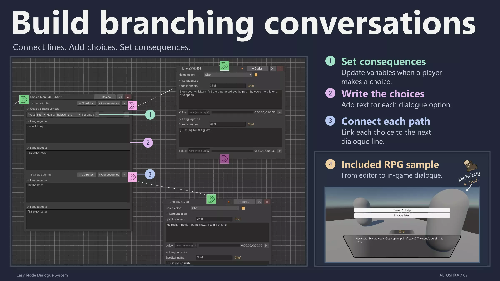
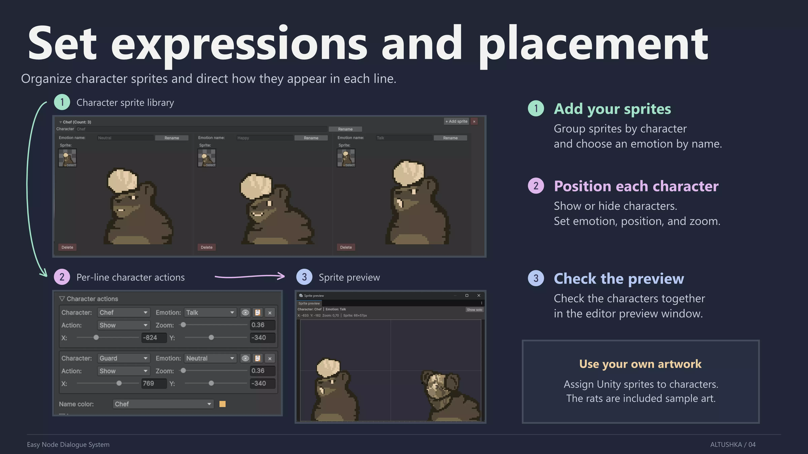
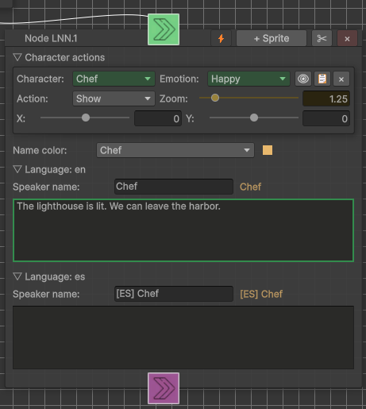

# Easy Node Dialogue System with MCP - ENDS

A visual dialogue system for Unity with branching conversations, variables, localization, character presentation, and optional AI-assisted editing through MCP.

[Unity Asset Store](https://assetstore.unity.com/packages/slug/390618) | [Install from Git](#installation) | [Download .unitypackage](https://github.com/Saris-S/ends/releases/latest) | [User manual](Documentation/README.md) | [Changelog](Documentation/CHANGELOG.md)



## Features

- **Branching graphs:** Connect dialogue lines, choices, conditions, and redirects. Validate connections and variable references.
- **Variables and consequences:** Control branching with bools, ints, floats, and strings. Apply numeric rewards or costs and save runtime values to JSON.
- **Localization:** Translate dialogue, choices, and speaker names. Import and export dialogue and choice translations through CSV.
- **Characters and voice:** Configure speaker names, colors, character sprites, emotions, and line voice clips.
- **Optional MCP editing:** Let a compatible AI client edit dialogs, inspect changes and highlights, then save or discard selected work. Manual and client edits share Unity Undo/Redo.
- **Runtime and examples:** Use the supplied dialogue UI, RPG and Visual Novel scenes, or integrate playback through the C# API.

## Character presentation

Organize character sprites by emotion, set their position and zoom for each line, and preview them together in the editor.



## Requirements

Tested with Unity 6000.4.

- **TextMeshPro** (required for the core dialogue UI).
- **Input System** (required **only** for the RPG sample scene).

## Installation

Choose one installation method:

**Unity Asset Store:** import [ENDS](https://assetstore.unity.com/packages/slug/390618) into your project.

**.unitypackage:** download the package from [Releases](https://github.com/Saris-S/ends/releases/latest) and open it in Unity.

**Git / Package Manager:** open **Window -> Package Management -> Package Manager**, choose **Install package from Git URL**, and paste:

```text
https://github.com/Saris-S/ends.git
```

Open **Tools -> Easy Node Dialog System** to start editing.

For updates, see the [upgrade guide](Documentation/README.md#upgrading-from-the-old-core-folder-layout).

## Try the samples

With Package Manager, select ENDS and import an example from **Samples**.

For the supplied UI, import **Window -> TextMeshPro -> Import TMP Essential Resources** if needed.

Open either scene from the imported sample:

- **RPG:** `RPG Game Sample.unity`
- **Visual Novel:** `Visual Novel Sample.unity`

Press **Play**. See the [quick start](Documentation/README.md#quick-start-samples) for interaction controls and runtime setup.

## Connect an MCP client

Use the editor's MCP connection settings to start the server and configure your client with the displayed endpoint.

See [Connecting an MCP client](Documentation/README.md#connecting-an-mcp-client) in the user manual.

Review the client's pending edits in Unity and save or discard the intended changes.

Yellow marks identify pending AI edits. Green marks identify saved AI edits awaiting acknowledgement.



## Contact the Developer

Report reproducible issues through [GitHub Issues](https://github.com/Saris-S/ends/issues). Include the Unity version, relevant editor or runtime steps, and a minimal example where possible.

Contact: [altushka.dev@outlook.com](mailto:altushka.dev@outlook.com).

## License

[MIT](LICENSE). Copyright 2026 ALTUSHKA (Saris-S).
